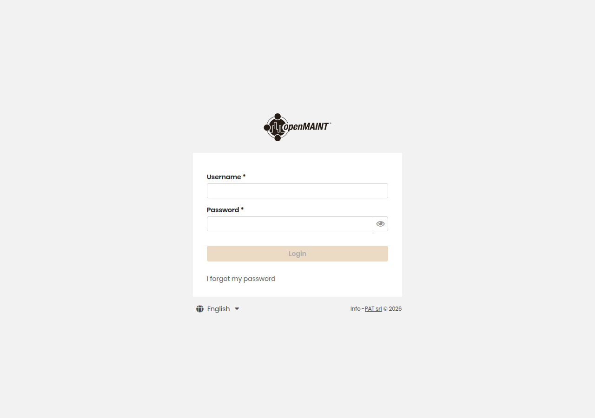
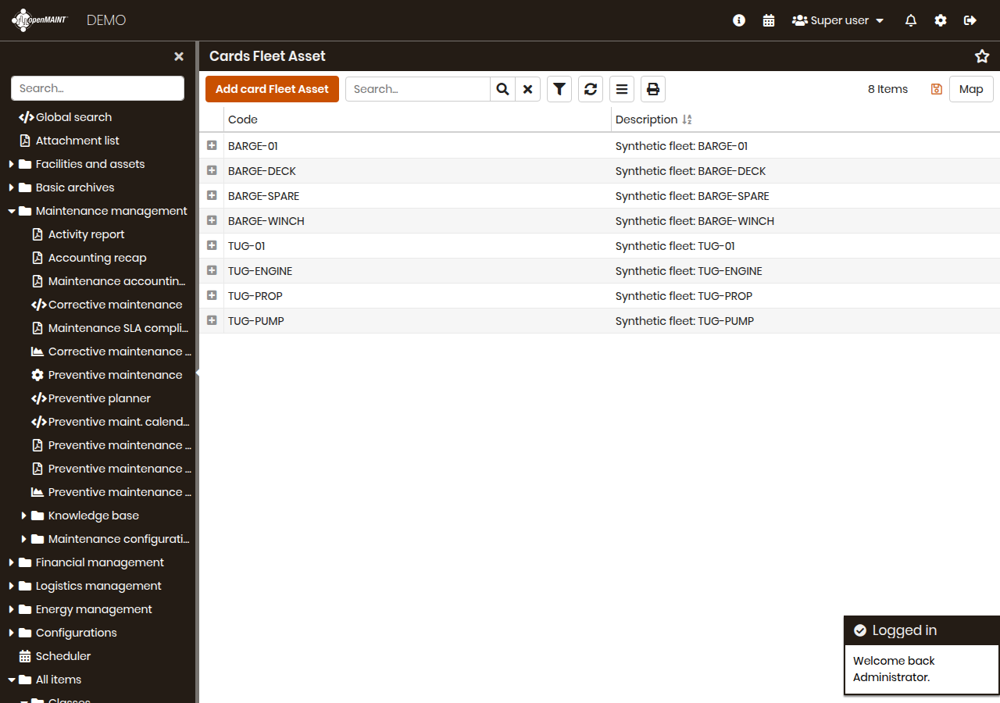
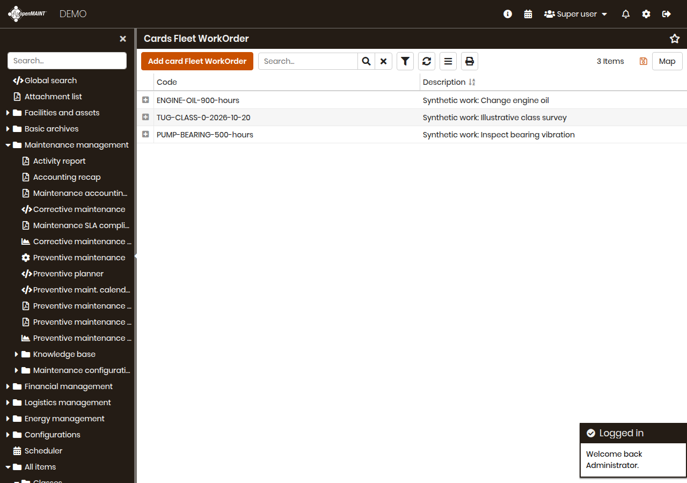

# Follow a small fleet's maintenance

I added a fleet maintenance notebook because I wanted to learn how the same idea as batch traceability applies to equipment: keep the asset, its service plan and the work record together. I do not own or operate this fleet. Every tug, barge, serial number, meter reading, cost and survey date here is synthetic.

The notebook runs inside [openMAINT](https://www.openmaint.org), an open-source maintenance system built by Tecnoteca on CMDBuild. I added three fleet-specific record types to the real application: **Fleet Asset**, **Fleet Plan**, and **Fleet Work Order**. The work orders are API-created cards, meaning stored records with a history. They do not run openMAINT's bundled building-maintenance workflow or approve work automatically.

## 1. Start a disposable system on Linux

These commands need Docker Compose and Python 3.11 or later. Docker packages the application and database so their versions stay consistent. Allow about 4 GB of memory and several GB of disk on the Linux machine. Do not start this stack on Jack's Mac.

```sh
python3 -m venv .venv
. .venv/bin/activate
pip install -r maintenance/requirements.txt
export MAINT_DB_PASSWORD="$(python -c 'import secrets; print(secrets.token_hex(24))')"
docker compose -f compose.maintenance.yaml up -d
python -m maintenance wait
python -m maintenance demo --output artifacts/maintenance
```

The first start restores the application's demo database. The Compose file pins the openMAINT 2.4.2 / CMDBuild 4.2.0 image and PostGIS database by digest. The app binds only to `127.0.0.1:8090`. This is an isolated demo with the upstream `admin` / `admin` login, not a production setup. For another instance, set `MAINT_URL`, `MAINT_USER` and `MAINT_PASSWORD`. Remote URLs require HTTPS.

## 2. Look at the records

Open [the local login](http://127.0.0.1:8090/cmdbuild/ui/) in a browser on the Linux machine. Log in as `admin` with password `admin`.



Open [Fleet Asset](http://127.0.0.1:8090/cmdbuild/ui/#classes/FleetAsset/cards). The eight records describe a tug and a barge. Each record has a vessel code and a parent code. For example, **TUG-01 → TUG-PROP → TUG-ENGINE** means vessel, propulsion system, then engine. The importer checks that each parent exists, stays within the same vessel and does not make a loop.



Open [Fleet Plan](http://127.0.0.1:8090/cmdbuild/ui/#classes/FleetPlan/cards). The six plans include engine oil changes every 250 running hours, bearing checks every 500 hours, a dated winch service, and illustrative class and regulatory surveys. Actual survey requirements depend on the vessel and authority; these dates are examples, not compliance advice.

Open [Fleet Work Order](http://127.0.0.1:8090/cmdbuild/ui/#classes/FleetWorkOrder/cards). At the frozen demonstration date of **November 1, 2026**, the engine oil change, bearing check and tug survey are due. The script creates three open work records through the real REST API, the interface used to read and write application data. Running it again reuses the same work records.



The screenshots above come from the headless browser in the `Fleet maintenance` GitHub Actions job. Its `fleet-maintenance-evidence` artifact also contains the full-size screenshots and JSON reports. They show real screens and synthetic records, not interface mockups.

## 3. Understand a due decision

The script compares current running hours with **last service hours + service interval**. A calendar deadline is a separate trigger. If either has been reached, the plan is due. Both reasons are kept if both apply. A meter that moved backward or a plan without a trigger requires review.

`generate_work_orders(api, today)` in `maintenance/seed.py` accepts the date explicitly. The demo deliberately freezes it to make the comparison reproducible. For another as-of date, call it from Python with `date(year, month, day)`. It creates at most one work card per plan and maintenance cycle. It does not invent completed work or advance the meter. After doing real work, a reviewer would close the card and record the new last-service hours or next date on the plan. Those plan updates define a new cycle.

## 4. Review the audit and migration

Read `artifacts/maintenance/fleet-report.json`, or the [committed real API report](reports/fleet-maintenance.json). It contains:

- the reconciliation between the old-format CSV and records read back from openMAINT;
- the assets, service plans and API-created work orders;
- equipment without an explicit plan, duplicate serial numbers, missing hierarchy or readings, missing failure codes, duplicate tasks and overdue plans;
- a one-year budget and survey forecast grouped by vessel.

A failure code is a short label such as `LUBE` or `BEARING` explaining what problem the work addresses. The spare barge component deliberately has no plan so the audit has a visible finding. Systems without their own plan also appear, even if components below them have plans.

`examples/maintenance/legacy-assets.csv` uses old-style column names. `maintenance/migration.py` maps them explicitly and checks all rows before writing. Duplicate asset numbers, bad meters and broken parent links stop the import. Existing cards are never overwritten. A different serial number on a repeat import appears as a reconciliation mismatch for a person to resolve. Each API request commits separately, so inspect the report before retrying a partial failure.

The cost forecast is an undiscounted planning example. `DailyHours` is an explicit synthetic usage assumption. Replacement costs are additive allocations: vessel rows cover hulls, system rows cover other system parts, and component rows cover those components. They are not overlapping quotes for whole assemblies. The forecast combines these allocations with estimated scheduled service costs; it is not an accounting valuation or a prediction of unscheduled failures.

## 5. Compare bearing, thermal and oil readings

```sh
python -m maintenance.public_vibration --output artifacts/maintenance/vibration.json
```

This downloads two small public laboratory recordings from the [Case Western Reserve University Bearing Data Center](https://engineering.case.edu/bearingdatacenter/download-data-file). File `97.mat` is normal and `105.mat` has a deliberately introduced inner-race fault. The normal drive-end channel was collected at 48 kHz, so it is reduced to 12 kHz with an anti-alias filter before comparison. Only two seconds from each file are analysed; downloaded files are not kept.

An FFT separates a vibration signal into frequencies. Envelope analysis measures repeated impacts after filtering around a higher-frequency bearing response. The script looks near the inner-race frequency calculated from motor speed and the university's [published bearing factor of 5.4152](https://engineering.case.edu/bearingdatacenter/bearing-information). It compares the proportion of envelope energy in that frequency band between the labelled normal and fault recordings, and saves each source URL and SHA-256 checksum.

The [committed vibration report](reports/vibration.json) records a normal bearing-band energy fraction of 0.00364 and a fault fraction of 0.37496, with the fault envelope peak at 161.5 Hz. These results are from the actual public recordings, not generated waveforms.

The same report trends synthetic bearing-temperature rises above ambient, iron in oil and viscosity changes. The thresholds are illustrative. Two labelled bench recordings and generated thermal/oil readings do not validate a fault classifier, remaining-life model, or a vessel safety decision.

## 6. Run checks and stop

```sh
python -m unittest discover -s tests -p 'test_maintenance*.py' -v
MAINT_INTEGRATION=1 python -m unittest discover -s tests -p test_maintenance_integration.py -v
python -m playwright install chromium
python -m maintenance.screenshots --output artifacts/maintenance
docker compose -f compose.maintenance.yaml down --volumes --remove-orphans
```

The integration test talks to the actual running system. It creates eight assets and six plans, reads them back, checks migration reruns and mismatches, creates due work orders and confirms that a repeat run uses the same IDs. Separate tests exercise meter and date boundaries, missing plans, duplicate assets, missing failure codes, reconciliation drift, FFT and envelope frequencies, and thermal/oil trends. The GitHub workflow always removes its containers and volumes and closes its headless browser pages, including on failure.

The REST client uses [CMDBuild's documented REST v3 routes](https://www.cmdbuild.org/file/manuali/versione-4.0/cmdbuild_webservicemanual_eng_v40.pdf). It logs in to obtain a session, sends that session in the `CMDBuild-Authorization` header, pages through records and logs out. Credentials never appear in reports.
